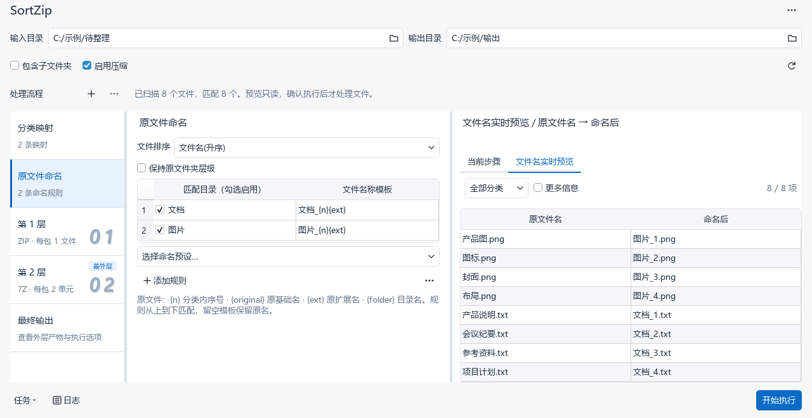

#  SortZip

[简体中文](README.zh-CN.md) · **English**

SortZip is a Windows utility for organizing files. Sort files into folders by extension, rename them in batches, preview the result, and optionally package them into archives. Use it to organize a downloads folder, archive project files, or split a delivery into several archives.

[Download SortZip](https://github.com/WindySumm/SortZip/releases) · [Changelog (Chinese)](CHANGELOG.md) · [Development and build guide (Chinese)](DEVELOPMENT.md)



## Download and run

Download the Windows x64 EXE from GitHub Releases and run it. You can sort and rename files without installing a compression tool. To compress files, install one of the tools below and select it under **Final output**. Use **Settings** in the top-right menu to set and test its executable path.

On first launch, SortZip follows your system's preferred display languages. It supports Simplified Chinese and English, with English as the fallback. To override this, choose **Settings → Language** and restart SortZip.

| Tool | Formats | Passwords and split volumes |
| --- | --- | --- |
| [Bandizip](https://www.bandisoft.com/bandizip/) · `bz.exe` | ZIP, 7Z, TAR, LZH, GZ, XZ | ZIP, 7Z |
| [7-Zip](https://www.7-zip.org/) · `7z.exe` | ZIP, 7Z | ZIP, 7Z |
| [WinRAR](https://www.rarlab.com/) · `Rar.exe` | RAR5 | RAR5 |

All layers in a task use the same tool. Each layer can use a different format supported by that tool. A GZ or XZ archive can contain one file.

## First task

1. **Choose folders.** Set the input and output folders. You can choose the input folder's parent. For example, sort videos from `Downloads\Course` into `Downloads\Videos`. Enable **Include subfolders** when needed.
2. **Map file types.** Under **File type mappings**, map an extension to a folder, such as `.txt` to `Documents`.
3. **Preview names.** Under **Rename files**, set the order and add rules. For example, `Document_{n}{ext}` produces numbered names. A blank template keeps the original name.
4. **Set up compression.** Under **Layer 1**, choose the files per archive, format, and archive naming template. Use **＋** next to the workflow heading to add another layer. Turn off **Enable compression** for a classification and renaming task.
5. **Review and run.** Under **Final output → Keep files and archives**, expand the archive summary to choose which inner layers to keep. A new compression profile keeps only the outermost layer by default. Select **Keep original files in the input folder** to copy source files. If you leave it off, SortZip moves them.

## Nested archives and split volumes

The first layer groups individual files. In later layers, each archive from the previous layer counts as one input, even if it spans several volumes. For example, if the first layer produces split archives A, B, and C, a group size of two puts all volumes of A and B in one archive and all volumes of C in another.

Password protection, split volumes, and verification depend on the archive format. Leave the password blank to skip encryption, or enter at least eight characters twice. 7-Zip requires printable ASCII passwords for ZIP. Avoid double quotes when using 7-Zip or WinRAR. Passwords are kept for the current session.

Outermost archives go directly in their category folder. Retained inner archives go in `layer-1`, `layer-2`, and so on under the category.

You can change the filename extension of the outermost archive. A ZIP shown as `.data` still contains ZIP data. When needed, new tasks put one launcher at the top of each category folder. Double-click `Restore-Names.cmd` or `还原压缩包后缀.cmd` to restore matching volume names, including volumes in category subfolders. Copy the CMD with the complete volume sets and preserve their relative locations. The launcher shows progress and closes on success. It stays open if a volume is missing, fails verification, or has a name conflict. Older deliveries still use the launcher in `Restore-Archive-Names`. SortZip can automatically unpack volumes whose names have already been restored.

## Output and recovery

- **File list.** Enable **Write file list** to record original relative paths and new filenames in each category's `List.txt`. For compressed tasks it also lists the actual outermost entry volume, its standard name, and the number of archive files. Two spaces separate the columns, each cell is centred by display width, and long names wrap. For consistent alignment, use a monospace font with Chinese support and turn off editor word wrap. Review the list before sharing because it may reveal original filenames and subfolder names.
- **Cancel and resume.** After an interruption, keep the output's `.sortzip-recovery` folder. Choose **Task → Resume task** and pick the checkpoint in the folder marked with the start time and category, or drop it on the Task button. SortZip cleans up its recovery data after success. Older checkpoints can still be opened from their original locations. New tasks on local Windows drives use a system lock. Network shares can still contain a lock file.
- **Protect checkpoints.** An encrypted task's checkpoint stores password verification data that allows offline guessing attempts. Keep checkpoints private when sharing archives.
- **Disk space.** The confirmation shows free space, estimated writes, and the stage with the highest estimated space usage on each volume. It also shows the largest inner layers you chose to keep. SortZip stops if a copy cannot fit. You can proceed if only the compression estimate is tight, or resume after freeing space.
- **Cleanup.** SortZip removes working files and unselected inner archives only after the next layer passes its integrity and member checks and the checkpoint is saved. A missing file or volume stops cleanup for that group. Classification-only tasks keep the classified files. When resuming an older checkpoint, SortZip keeps any inputs still present for groups without a recorded member check.
- **Restore original filenames.** Enable **Include original filename restoration scripts** under **Final output** when you want recipients to see the original filenames. Extract each layer manually and give each innermost archive its own folder. Run the launcher in that folder. It is named `SortZip-Restore-Names.cmd` in English or `还原原文件名.cmd` in Chinese, depending on the sender’s SortZip language. It verifies files and reports the path of any conflict before proceeding. If interrupted, keep the extracted files, temporary files and restore files together, then run the same command again. GZ and XZ cannot include the script.

Open **User Guide** from the top-right menu for more details.

## Unpack nested SortZip archives

Under **Final output → SortZip Unpack and Restore**, enable **Create automatic unpack manifest**. New Bandizip and 7-Zip tasks create one manifest in the output folder, named for the category and start time, such as `Videos-2026-11-15_1425.sortzip.json`. SortZip adds a number when needed and keeps the chosen name on resume. Share that file and the complete outer volume sets you want to send, keeping their paths relative to the manifest. The manifest reveals archive structure, current names, and relative folders. **Automatically restore original filenames** adds the original filenames to the manifest. The standalone rename script and `List.txt` have separate settings and can also reveal original names. RAR5 currently uses the earlier per-archive manifest format.

Open **Task → Unpack and restore** and choose the manifest and an output folder. Select which complete outer archives to unpack and, for each, which inner layers to keep and whether to restore original names if available. SortZip restores the source folder structure under the output folder. Verified matching files are reused on retry, and conflicting files are left in place. Use the same manifest and output folder to continue. Older per-archive manifests keep their existing result layout and retention options.

Selected inner layers go under **Retained archives**. The delivered volumes stay in place. Unfinished groups keep recovery data in `.sortzip-recovery` under a folder named for the archive and start time, including the choices made when each group first started.

By default, share archive passwords separately. When creating a task manifest with encrypted layers, choose **Encrypt passwords with a delivery passphrase** to include their passwords in encrypted form. Set and confirm a separate passphrase of at least 12 characters, then share it separately from the manifest. The recipient enters that passphrase to unlock the included passwords. Filenames and other manifest details remain readable. Anyone with a plain-text manifest can read its passwords. SortZip can also try passwords supplied for the current unpack task in order. If 7-Zip cannot distinguish a wrong password from archive damage, SortZip tries the remaining entries before asking what to do. Software with access to local process arguments may see a password while an archive tool runs.

## Run from source

```powershell
python -m venv .venv
.\.venv\Scripts\python.exe -m pip install -r requirements.txt
.\.venv\Scripts\python.exe main.py
```

See [DEVELOPMENT.md](DEVELOPMENT.md) for tests and packaging. SortZip uses the MIT license.
