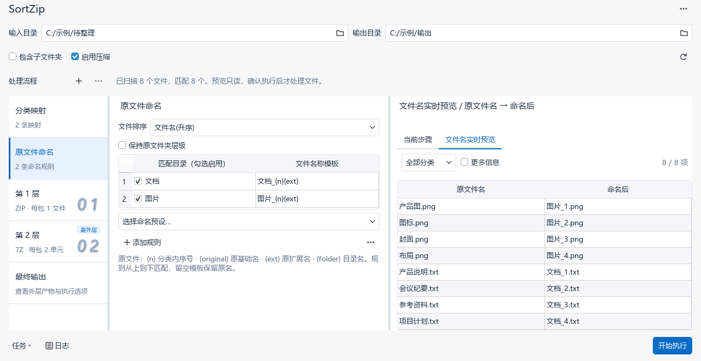

#  SortZip

**简体中文** · [English](README.md)

SortZip 是一个 Windows 文件整理工具。按扩展名分目录，按规则批量改名，在同一个工作台预览结果，再按需分组压缩。适合整理下载目录、归档项目资料，或把一批文件分成便于交付的多个压缩包。

[下载 SortZip](https://github.com/WindySumm/SortZip/releases) · [版本记录](CHANGELOG.md) · [开发与构建](DEVELOPMENT.md)



## 下载与运行

在 GitHub Releases 下载 Windows x64 版 EXE 并运行。分类和重命名可直接使用。需要压缩时，安装下列任一工具，然后在「最终输出」选择。程序路径可在右上角菜单的「设置」中指定并检测。

首次启动按系统首选显示语言选择简体中文或英语，其他语言使用英语。也可以在「设置 → 界面语言」手动选择，重启 SortZip 后生效。

| 压缩工具 | SortZip 支持的格式 | 支持加密与分卷的格式 |
| --- | --- | --- |
| [Bandizip](https://www.bandisoft.com/bandizip/) · `bz.exe` | ZIP、7Z、TAR、LZH、GZ、XZ | ZIP、7Z |
| [7-Zip](https://www.7-zip.org/) · `7z.exe` | ZIP、7Z | ZIP、7Z |
| [WinRAR](https://www.rarlab.com/) · `Rar.exe` | RAR5 | RAR5 |

一个任务的所有压缩层共用同一工具，各层可以选用该工具支持的不同格式。GZ 和 XZ 每包只能包含一个实体文件。

## 第一次使用

1. **选文件夹。** 填写输入和输出目录。输出可选输入的上一级，例如把 `下载\课程` 的视频整理到 `下载\视频`。需要处理下级目录时，勾选「包含子文件夹」。
2. **做分类。** 在「分类映射」把扩展名对应到目录，例如把 `.txt` 放入「文档」，把 `.png` 放入「图片」。
3. **预览新名称。** 在「原文件命名」选择排序方式、设置命名规则。比如给「文档」使用 `文档_{n}{ext}`，右侧会实时显示原文件名和新名称。模板留空时保留原名。
4. **配置压缩。** 在「第 1 层」填写每包文件数、格式和归档名称。需要再打包一层时，点击流程标题旁的「＋」。只想分类和改名时，关闭「启用压缩」。
5. **核对后执行。** 在「最终输出 → 保留产物」展开归档摘要，选择要保留的内层。新压缩配置默认仅保留最外层。初次试用可勾选「保留输入目录中的原始文件」，让 SortZip 复制源文件。关闭这个选项时，分类会移动源文件。

## 多层打包与分卷

第一层按文件分组。第二层起，每一包按上一层的**完整归档单元**计数。比如第一层生成 A、B、C 三套分卷，第二层每包 2 个单元，结果就是「A 的全部卷＋B 的全部卷」和「C 的全部卷」。

各层可独立设置密码、分卷大小和完整性校验，具体选项随格式而定。密码留空时该层不加密，填写时至少 8 位并输入两次。7-Zip 加密 ZIP 时使用可打印 ASCII 字符，7-Zip 和 WinRAR 的密码避免双引号。层密码保留在当前会话。

最外层压缩包直接放在分类目录。手动保留的内层放在分类下对应的 `layer-1`、`layer-2` 等目录。

只有最外层可以更改显示后缀。比如把 ZIP 显示为 `.data`，归档内容仍是 ZIP。新任务在每个分类根目录生成一个双击入口，中文为 `还原压缩包后缀.cmd`，英文为 `Restore-Names.cmd`。它也覆盖该分类子目录下的卷组。交付时把 CMD 和所需卷组一同复制，并保留相对位置。还原时显示检查进度，全部成功后自动关闭。缺卷、校验失败或名称冲突时，窗口保留结果。旧交付可继续从 `Restore-Archive-Names` 文件夹启动。SortZip 自动解包也能识别已改回标准名称的卷。

## 输出与任务恢复

- **对应清单。** 勾选「输出文件对应清单」后，各分类下会生成 `List.txt`，记录原相对路径和新文件名。压缩任务还记录最外层实际入口卷、标准入口卷名和归档文件数。列间留两个空格，单元格按显示宽度居中，长名称折行。建议用支持中文等宽显示的字体查看，并关闭编辑器的自动换行。清单可能包含原文件名和子目录名，分享前请先核对。
- **中断后继续。** 新任务中断后，请保留输出目录下的 `.sortzip-recovery`，从「任务 → 恢复任务」选择其中标有开始时间和分类名的目录里的断点。任务成功后自动清理恢复记录。旧断点可从原位置导入。Windows 本机磁盘上的新任务使用系统锁。网络共享仍可能看到锁文件。
- **保管断点。** 加密任务的断点含密码校验数据，持有者可离线尝试猜测密码。交付时只需复制所需的归档、清单和后缀还原文件。
- **磁盘空间。** 确认界面按盘显示可用空间、预计写入量、峰值出现的阶段及占用较大的保留内层。复制空间不足时停止，压缩估算偏紧时可确认继续。腾出空间后可从断点恢复。
- **产物清理。** 下一层归档通过完整性和成员校验，并写入断点后，才清理已用完的工作文件和未选保留的内层归档。漏文件或漏卷时保留该组输入。只分类、改名时保留分类结果。恢复旧断点时，已完成但未记录成员校验的组保留尚存输入。
- **原文件名还原。** 想把原文件名也交付给对方时，在「最终输出」勾选「随包附带原始文件名还原脚本」。手动逐层解压，把每个最内层归档解到独立目录，再双击 `还原原文件名.cmd`（英文入口为 `SortZip-Restore-Names.cmd`）。脚本会校验文件并报告有冲突的路径。若中断，请保留解压文件、临时文件和还原文件，再次运行同一脚本继续。GZ 和 XZ 无法随包附带脚本。

更多操作说明可在 SortZip 的右上角菜单打开「使用手册」。

## 自动逐层解包

在「最终输出 → SortZip 解包并恢复」勾选「生成自动解包清单」。Bandizip 和 7-Zip 的新任务在输出目录生成一份以分类和开始时间命名的总清单，例如 `视频-2026-11-15_1425.sortzip.json`。同名时追加序号，续跑沿用已确定的名称。分享总清单及需要交付的完整外层卷组，并保留卷组相对清单的位置。清单会公开归档结构、整理后文件名和相对目录。勾选「自动恢复原文件名」后，原名也写入清单。随包手动改名脚本和 `List.txt` 独立控制，也可能包含原名。RAR5 目前沿用每包一份清单的格式。

收件人从「任务 → 解包并恢复」导入总清单并选择输出目录，可勾选要解包的外层包，并逐包选择保留哪些内层、是否恢复原名。文件直接按来源的相对目录还原到输出目录。续跑时，内容一致的文件会复用，冲突的文件保留原样并报告路径。旧清单继续使用原来的输出目录结构和保留设置。

保留的内层归档按层放在「保留的压缩包」下，外层源卷留在原位。未完成组的恢复数据保存在输出目录的 `.sortzip-recovery`，子目录以归档名和开始时间标记。用同一清单和输出目录重试，仍沿用该组首次开始时的选择。

密码默认单独传递。任务有加密层并生成总清单时，选择「用交付口令加密」可加密附带各层密码。设置并确认一条至少 12 个字符的独立口令，交付时与清单分开传递。收件人输入交付口令即可解锁附带的密码。文件名和归档结构仍可直接读取。选择明文附带时，拿到清单的人可以读取压缩密码。解包也可使用本次任务输入的密码清单依次尝试。7-Zip 无法区分密码错误和归档损坏时，SortZip 试完清单后再提示。工具运行时，本机有权查看进程参数的程序可能看到命令行密码。

## 从源码运行

```powershell
python -m venv .venv
.\.venv\Scripts\python.exe -m pip install -r requirements.txt
.\.venv\Scripts\python.exe main.py
```

测试、打包和模块说明见 [DEVELOPMENT.md](DEVELOPMENT.md)。

项目采用 MIT 许可。
